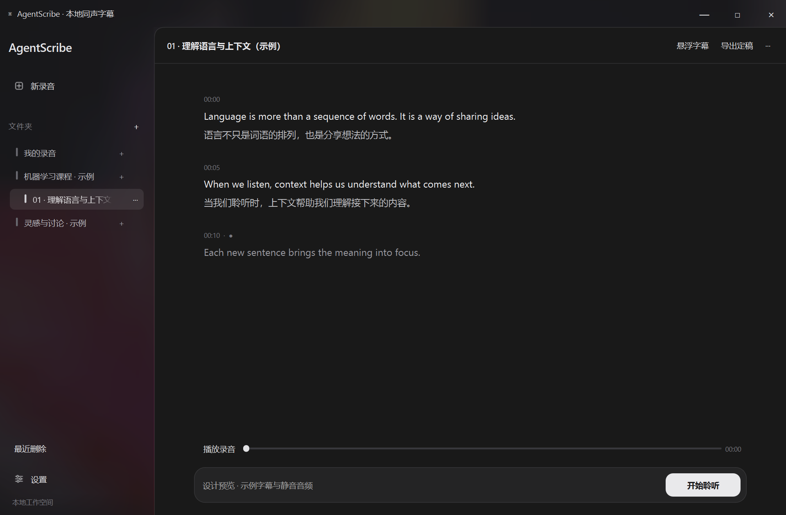

# AgentScribe

本地语音识别与双语字幕桌面应用，面向外语课堂、讲座和讨论。边听边读，课后回听原声、查找字幕、导出复习。

**[Mac 下载](https://github.com/Rand0MGG/agentscribe-local/releases/tag/v0.11.0)** · **[Windows 预览版](https://github.com/Rand0MGG/agentscribe-local/releases/tag/v0.11.0)** · [源码与使用指南](docs/WORKSPACE.md)

*示例字幕与界面，不是模型质量或平台验收证据。*

## 主要能力

- 本地 Qwen3-ASR / Whisper 识别与本地翻译；环境和模型准备后可断网运行，不消耗云端转写分钟数。
- 原文随音频修订，结合语义分句与上下文翻译；草稿、初译和定稿明确区分，重要内容仍需对照原声。
- 麦克风/系统声音、暂停继续、可拖动悬浮字幕；录音与字幕本地保存，支持文件夹、回听、查找和 SRT/TXT/Markdown 导出。
- 可选 Beta 课程助手：导入静态课件、完整阅读、审核术语及有来源笔记。默认关闭，云端图文/笔记分别授权，不上传音频；真实理解与笔记质量待验收。

核心识别/翻译不上传音频或字幕；主动启用课程云功能后，会按许可发送对应课件和已保存文字。本地运行需要兼容硬件、下载空间和首次准备，不保证任意设备实时运行。

## 获取与开始

| 平台 | 获取方式与范围 |
| --- | --- |
| Apple Silicon Mac | `v0.11.0` DMG，最低 macOS 15；未完成 Developer ID/公证，不支持 Intel/Rosetta。按发行说明安装。 |
| Windows x64 | `v0.11.0` 预览安装器，未做 Authenticode 签名，真实录音及旧版升级待验收；也可 [源码安装](docs/WORKSPACE.md#windows-源码安装)。整套推理环境要求兼容 NVIDIA GPU/驱动。 |

准备模型 → 新录音 → 开始聆听；来源、语言、文件夹和名称按需修改。停止保存后可回听或导出。源码中的新功能不自动出现在旧安装包中；已知实现缺口见 [计划](docs/ROADMAP.md#实现缺口)，真实设备、长会话及各平台证据见 [验证索引](docs/VALIDATION.md)。现有短样本不构成全面准确率或同类产品比较。

当前源码版本为 **0.12.1**，采用 Electron 正式入口；Python 后台及正式安装依赖已移除 Qt，现有录音采集方式保留。此源码变更不代表上述旧安装包已更新。

## UI Demo 与开发基准

[界面规范与 Demo 入口](docs/UI_DESIGN.md#demo-一致性与优先复用) 是产品 spec 的一部分。后续界面优先复用组件 Demo 与正式流程 Demo 使用的共享实现，保持交互逻辑、视觉风格、外观及状态反馈一致；新增能力同步维护 Demo 与正式页面。

[全部发行](https://github.com/Rand0MGG/agentscribe-local/releases) · [反馈问题](https://github.com/Rand0MGG/agentscribe-local/issues) · [文档地图](docs/PROJECT_STRUCTURE.md) · [开发约定](AGENTS.md) · [第三方说明](THIRD_PARTY_NOTICES.md)
