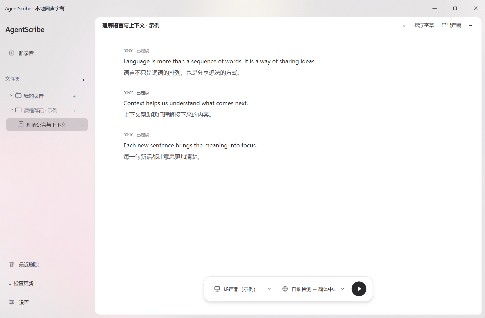
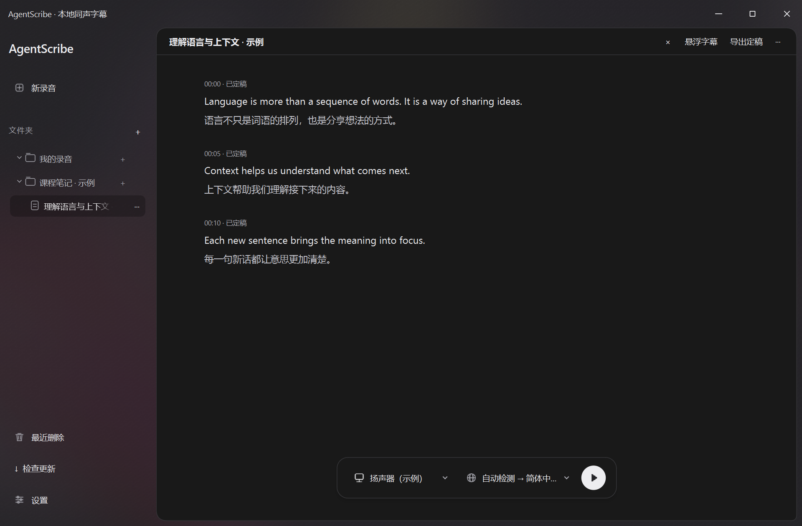

# 界面规范

正文易读、常用操作直达，Windows/macOS 共用交互。业务约定见 [spec](specs/README.md)，操作见 [指南](WORKSPACE.md)，实现见 [架构](ARCHITECTURE.md)；实现与验收缺口见 [计划](ROADMAP.md)。

## 布局与呈现

- 左侧录音库，右侧纯色正文；顶部与侧栏共用背景。正文填充与边框共用圆角轮廓，右侧、底部贴合窗口，不留半透明间隙或露出方形底板；录音和设置页一致。
- 明暗主题共用尺寸、字重和间距，复用现有组件与图标。品牌与正文标题视觉对齐；导航图标、文字列与根文件夹对齐，笔画完整位于悬停背景内，不靠负坐标补偿。
- 标题使用常规字重，悬停不加底色或阴影；长标题省略并提供全文提示。窄窗口将课程 Beta 入口收入“更多”，优先保留标题与主要操作。
- 普通按钮用背景表达悬停、按压，不叠阴影或残留焦点圈；小岛、音量浮层与菜单共用轻阴影。提示气泡匹配主题、限制宽度、保持在屏幕内，离开或操作即收起。
- 正文上下边缘以渐隐衔接，避免字幕穿过控件或从控件间隙透出；渐隐层不拦截鼠标。背景材质缓存并在后台生成，不随字幕重复模糊，不承诺真实透视或 10-bit 色深。
- 最小窗口 640×480；窄窗口、设置和弹层保持可操作，必要时滚动，长设备名可换行或省略并查看全文，不缩小主要文字硬塞内容。Mac 保留原生按钮、分屏与安全区，Windows 保留窗口按钮、缩放与 Snap；顶部不重复品牌。

当前尺度由组件与主题维护：侧栏导航高 38px，透明拖动区 36px，正文栏 40px；标题 16px、操作 15px、新录音 15px，导航笔画内缩 12px。平台安全区可提高下限。

## 录音与回放

- “新录音”直接进入待录音页，不弹创建表单。来源、语言、文件夹使用图标入口；摘要全部逐行居中于纯色面板，随缩放和侧栏调整定位。标题可原位改名，按下开始前不创建文件，不提供关闭录音按钮。
- 聆听中可改当前名称、管理其他录音；当前录音及祖先目录保留移动/删除保护，切换仍须先停止并保存。已结束的空录音显示“无内容”，活动会话显示聆听、暂停或故障状态。数据规则见 [录音规范](specs/recording.md)。
- 待录音小岛单行，不预留隐藏控件空间；录音时上行呈现状态、实际采集时长与音量，下行呈现来源、语言、暂停/继续和结束。当前录音宽 288px，上下留白平衡；尺寸切换采用 200ms 可中断过渡，不被隐藏页面撑高。
- 音量按输入呈现，暂停归零；计时按已接收 PCM，不计加载或暂停时间。来源列表底部提供刷新，空设备列表仍可打开；省略不改变选择，切源遵守会话代次。
- 回放的播放键、长进度条与时间同排。独立音量圆钮与小岛等高，点击向上展开并显示百分比，不挤短进度；支持最高 300%，格式限制须说明，数据与增益边界见录音规范。
- 滑块均支持点击定位和拖动，拖动不被旧回执覆盖。回听仅在实际字幕文字范围内短单击定位，空白、拖选、长按、双击及录音中不触发；可点文字有手形和即时悬停/按压反馈，播放句仅背景高亮，无左侧竖线。
- 手动滚动打断跟随；返回箭头指向播放句，句子可见时隐藏。用户将当前句滚入视野后，下一句沿用其窗口偏移平滑跟随；远离时保持阅读位置。查找只定位，新目标替换进行中的滚动，不堆积动画。

## 字幕与反馈

- 草稿、初译、定稿及过期译文明确区分。未分句原文立即预览，在原区域替代可修订尾部；正式字幕原位接续，不重复、伪定稿或提前触发翻译，悬浮字幕同步有效修订。
- 新增文字可渐显，修订立即替换；完整文字从开始就参与布局、复制与保存。命中区域按内容/字体/尺寸缓存，内容不变时避免重复排版。“减少动态效果”直接切换，保留跟随与业务行为。
- 悬浮字幕原文/译文字号一致，透明度只影响背景。隐藏控制栏与缩放柄后释放正文空间，保持位置尺寸；可拖动缩放，重开校正到可用屏幕，内容更新不重置位置。
- 状态覆盖加载、空、失败、取消和完成。成功保存静默更新，新录音页收起旧成功提示；失败、未完整结束与进行中任务保留。右上通知不抢焦点、不改变正文高度，进度刷新不重复弹出；取消和错误入口始终可找。
- 模型下载使用少量明确选择，高级参数按需展开；任务保留真实进度与取消，未知总量不编造百分比，完成不自动录音。自绘控件明确约束高度与边框，菜单独立布局；Windows 原生更新窗口不强行统一外观。
- 不注册应用快捷键或控制条专用焦点/按键行为；文本编辑、复制粘贴及系统控件沿用基础行为。动画不得改变业务状态或延迟保存。

## 图例与验收

图例来自 Windows 11/AMD64、Python 3.12.8、Qt Fusion、150% 缩放的真实 Qt 示例窗口。字幕、音量和进度为模拟数据；按逻辑尺寸/像素比比较，不能据此证明 Cocoa、权限、真实音频或模型性能。图片中的版本/路径不是发行证据。

补充图例：[空状态](images/ui/workspace-empty.png)、[640×480](images/ui/workspace-640x480.png)、[900×650](images/ui/workspace-900x650.png)、[700×960](images/ui/workspace-700x960.png)、[来源](images/ui/audio-sources.png)、[录音](images/ui/recording.png)、[回放](images/ui/playback.png)、[设置](images/ui/settings.png)、[字幕参数](images/ui/settings-captions.png)、[运行环境](images/ui/settings-runtime.png)、[模型下载](images/ui/model-download.png)、[悬浮控件](images/ui/overlay-controls.png)、[悬浮阅读](images/ui/overlay-reading.png)。

使用 `scripts/preview_workspace.py --capture --output .work/browser/ui-design-<平台>` 生成隔离示例，记录系统、主题、逻辑尺寸、缩放与状态。两端实机检查原生完整窗口、分屏/全屏/多显示器、字体及焦点；offscreen 仅验证客户端布局。

验收覆盖黑白主题、1280×840 及上述窄/竖窗口，中英混排、长名称、设置展开/到底、菜单与圆角裁剪、减少动态效果、连续追加/修订、悬浮位置保留与真实关闭。UI 测试拒绝绘制/资源销毁警告；设备、回听和模型另按 [TESTING](TESTING.md) 验收。
